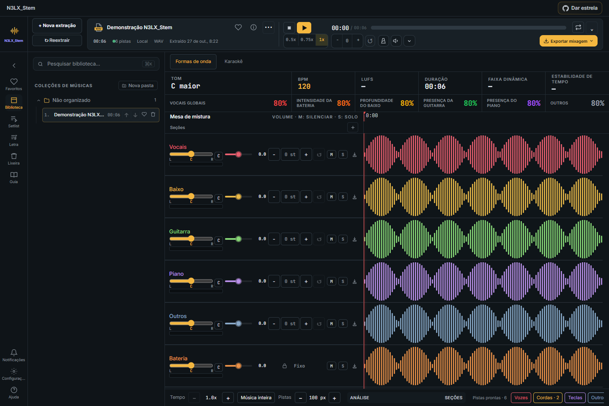
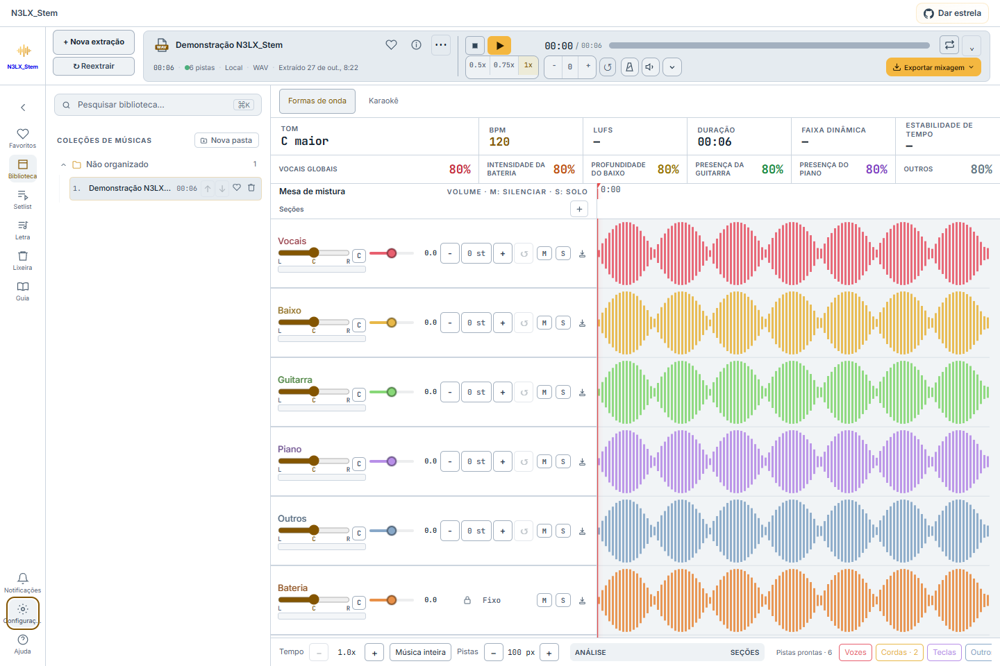

# N3LX_Stem

**Separe instrumentos, ajuste sua mixagem e pratique com karaokê no Windows.**

Aplicativo local derivado do [StemDeck](https://github.com/stemdeckapp/stemdeck), com adaptações para GPU AMD, biblioteca persistente, playlists e uma interface de estúdio.

[**Baixar para Windows — rc.5 (ZIP)**](https://github.com/nelsonseccofilho/N3LX_Stem/releases/download/v0.21.0-rc.5/N3LX_Stem-Windows-Update-0.21.0-rc.5.zip) · [Notas da versão e SHA-256](https://github.com/nelsonseccofilho/N3LX_Stem/releases/tag/v0.21.0-rc.5) · [Como atualizar](#atualizar-uma-instalação-existente)

> **0.21.0-rc.5 é uma pré-release.** O download é um pacote de atualização que usa os ambientes AMD e modelos de uma instalação existente. A validação de instalação limpa em outro computador e a aceitação musical completa continuam pendentes.



*Captura com áudio e dados sintéticos de demonstração. A quantidade de pistas varia com o modo e os detalhamentos disponíveis.*

<details>
<summary>Ver a interface no tema claro</summary>



</details>

## Atualizar uma instalação existente

1. [Baixe o ZIP da rc.5](https://github.com/nelsonseccofilho/N3LX_Stem/releases/download/v0.21.0-rc.5/N3LX_Stem-Windows-Update-0.21.0-rc.5.zip) e extraia **todo o conteúdo em uma pasta nova**, mantendo o executável, a pasta `resources` e os demais arquivos juntos.
2. Feche o aplicativo anterior e encerre seu servidor com **Stop-N3LX_Stem.cmd**, na instalação atual.
3. Abra **N3LX_Stem.exe** na pasta extraída.
4. Na primeira abertura, selecione a pasta da instalação AMD existente — aquela que contém `.venv`, `.venv-directml` e sua biblioteca `data`.

O pacote reutiliza os ambientes, ferramentas, pesos e biblioteca dessa instalação. Os áudios, modelos e configurações pessoais não estão incluídos no download. Preserve sua instalação anterior para poder retornar a ela. Evite substituir um checkout com alterações locais sem revisá-las primeiro.

Para conferir o arquivo, compare seu SHA-256 com o arquivo `.zip.sha256` disponível na [release](https://github.com/nelsonseccofilho/N3LX_Stem/releases/tag/v0.21.0-rc.5).

A rc.5 usa o WhisperGPU instalado para gerar e alinhar o JSON de karaokê em português, a partir da voz separada. Consulte [requisitos e validação](docs/KARAOKE_WHISPERGPU_RC5.md). A rc.4 reduz a largura dos controles de PAN e volume, mantendo o nome da pista acima do PAN. A rc.3 acrescentou uma tela de processamento do karaokê, com etapas reais, tempo decorrido e cancelamento. Gerar novamente retira o JSON anterior de uso antes de criar um novo; **Excluir JSON do karaokê** remove o resultado automático. Consulte a [validação desta correção](docs/KARAOKE_PROCESSING_RC3.md).

## O que você pode fazer

| Recurso | Na prática |
| --- | --- |
| **Separação local** | Extrair grupos de instrumentos e, quando disponíveis, detalhamentos de bateria, vozes e guitarras. A lista de pistas mostra o resultado efetivamente disponível. |
| **Mixer e PAN** | Ajustar volume, mudo, solo, posição estéreo e transposição por pista. O nome aparece acima do PAN; pistas percussivas mantêm a proteção de tom. |
| **Karaokê** | Alternar entre Formas de onda e Karaokê, editar e sincronizar letras, gerar novamente ou excluir o resultado automático preservando a letra manual e os stems. |
| **Whisper Large v3** | Escolher Large v3 ou Medium no karaokê. Large v3 é o padrão; a geração em português requer o WhisperGPU instalado, os pesos, Vulkan e o alinhador DirectML. |
| **Temas** | Escolher Claro, Escuro ou Padrão do sistema em **Configurações → Geral → Tema**. A preferência é salva e o modo Sistema acompanha mudanças do computador. |
| **Biblioteca e lixeira** | Organizar músicas, marcar favoritos, restaurar por botão e confirmar a exclusão definitiva pelo nome ou pela quantidade de itens. |
| **Reextração** | Criar uma nova extração de uma música local concluída cuja fonte foi preservada, mantendo a versão anterior e suas referências. |
| **Setlist e playlists** | Organizar a sequência de estudo ou ensaio e salvar uma mistura independente por música em cada playlist. |

### Playlists e reprodução

Adicione músicas já extraídas à **Setlist**, reordene-as e use os controles do mixer original. Volume, mudo, solo, PAN e transposição ficam separados da mistura da Biblioteca. Para repetir os ajustes, use **Aplicar esta mixagem a todas desta playlist**.

O Play avança pela lista ao terminar cada música. Pausar mantém a sequência; Parar interrompe o avanço. Contagem e metrônomo dependem de um mapa de batidas disponível. A próxima faixa precisa carregar áudio e mistura, portanto pode haver um pequeno intervalo na troca.

### Extração e progresso

A fila informa a etapa atual, os avisos e o progresso medido pelos workers quando disponível. O plano é salvo por extração, preservando o histórico de trabalhos antigos. Leitura, gravação e outras partes sem medição mostram atividade e tempo decorrido.

Falhas de detalhamento preservam o grupo original e são sinalizadas. Fechar a janela pode deixar o processamento em segundo plano; use **Stop-N3LX_Stem.cmd** para encerrar o serviço e seus workers.

## GPU AMD e processamento local

O desenvolvimento e os testes locais usam **Windows e AMD Radeon RX 6600M**. As rotas têm requisitos e limites próprios:

| Etapa | Rota disponível |
| --- | --- |
| Grupos de instrumentos — Demucs | Worker isolado com DirectML na AMD; operações incompatíveis, como parte do processamento complexo, usam CPU. |
| Detalhamento de bateria — DrumSep | Tenta DirectML quando configurado; falhas podem usar a alternativa em CPU, com aviso. |
| Voz principal e apoio — ONNX | Rota especializada em CPU na instalação documentada. |
| Estimativas de guitarra — SAM Audio | Recurso opcional com ambiente AMD separado e pesos autorizados. |
| Transcrição do karaokê — whisper.cpp | WhisperGPU instalado: reconhecimento via Vulkan e inferência de alinhamento via DirectML; CTC e algumas operações executam em CPU. Português; Large v3 e Medium são escolhas explícitas. |

O dispositivo disponível e a configuração determinam a execução. O teste curto do Large v3 confirmou logs de Vulkan na RX 6600M e produziu tempos por palavra; a qualidade de uma música cantada completa ainda requer revisão. Consulte os relatórios antes de assumir compatibilidade com outra GPU ou desempenho equivalente.

## Primeira preparação pelo código-fonte

Esta rota é destinada a quem ainda precisa preparar os ambientes locais. Ela pode baixar dependências e modelos. A instalação limpa em outro computador continua pendente de validação.

Pré-requisitos: **Windows, Python 3.12 de 64 bits** com o inicializador `py`, **Node.js 22.12 ou superior**, **Git**, **FFmpeg/FFprobe no PATH** e driver AMD compatível.

```powershell
git clone https://github.com/nelsonseccofilho/N3LX_Stem.git
cd N3LX_Stem
.\Setup-N3LX_Stem.cmd
.\Start-N3LX_Stem.cmd
```

O inicializador abre a janela Electron e prepara o servidor local. Ambientes Python, worker DirectML e ferramentas de karaokê/SAM têm configurações próprias; consulte a [documentação de instalação](docs/N3LX_STEM.md) e os guias especializados abaixo. Revise e preserve alterações locais antes de atualizar uma instalação pelo Git.

## Limites e validação

- A quantidade de pistas depende do modo, dos modelos disponíveis e dos detalhamentos concluídos. Resíduos preservam áudio restante; não representam instrumentos isolados adicionais.
- Piano e partes de guitarra são estimativas e podem conter vazamento. A separação não garante isolamento perfeito de instrumentos, overdubs ou efeitos de uma sessão de produção.
- A transcrição automática precisa de revisão de texto e sincronização. Excluir o karaokê gerado preserva o áudio e a letra manual, mantendo uma cópia de segurança privada do resultado anterior.
- O pacote Windows rc.2 foi aberto e verificado localmente. Foram conferidos os arquivos do pacote, sua arquitetura x64 e os hashes publicados.
- A validação local de integração registrou **49 testes Python aprovados, 1 teste indisponível neste Windows e 11 arquivos de testes JavaScript aprovados**. A revisão da interface registrou **23 verificações com dados sintéticos**.
- A validação local pode ser executada sem GitHub Actions. O workflow hospedado é opcional e tem acionamento manual. Consulte o [procedimento reproduzível](docs/LOCAL_RELEASE_VALIDATION.md) e a [evidência publicada](https://github.com/nelsonseccofilho/N3LX_Stem/releases/download/v0.21.0-rc.2/N3LX_Stem-local-validation-37df61a.zip).

## Documentação

- [Instalação AMD, arquitetura e ambientes](docs/N3LX_STEM.md)
- [Temas, lixeira, PAN, karaokê e validação da rc.2](docs/UX_UI_RC2_QA.md)
- [Revisão UX/UI, i18n e contrato do pacote Windows](docs/UX_UI_RELEASE_QA.md)
- [Validação local de release](docs/LOCAL_RELEASE_VALIDATION.md)
- [Detalhamento de guitarras com SAM Audio](docs/sam-audio-amd.md)
- [Bateria na AMD e alternativa em CPU](docs/drumsep-amd.md)
- [Modelos e seus termos](docs/models.md)
- [Documentação original do StemDeck](README-UPSTREAM.md)
- [Avisos de terceiros do pacote Windows](packaging/windows/THIRD_PARTY_NOTICES.txt)

## Origem e licença

Derivado de [StemDeck](https://github.com/stemdeckapp/stemdeck), preservando a licença [Apache-2.0](LICENSE), os avisos e os créditos dos autores originais. A revisão-base e a documentação herdada estão em [README-UPSTREAM.md](README-UPSTREAM.md). O nome interno do pacote Python e as chaves de armazenamento `stemdeck` permanecem por compatibilidade.

Os modelos e ferramentas externos têm seus próprios termos. Seus pesos não são redistribuídos neste Git. Use áudios que você tenha direito de processar.
